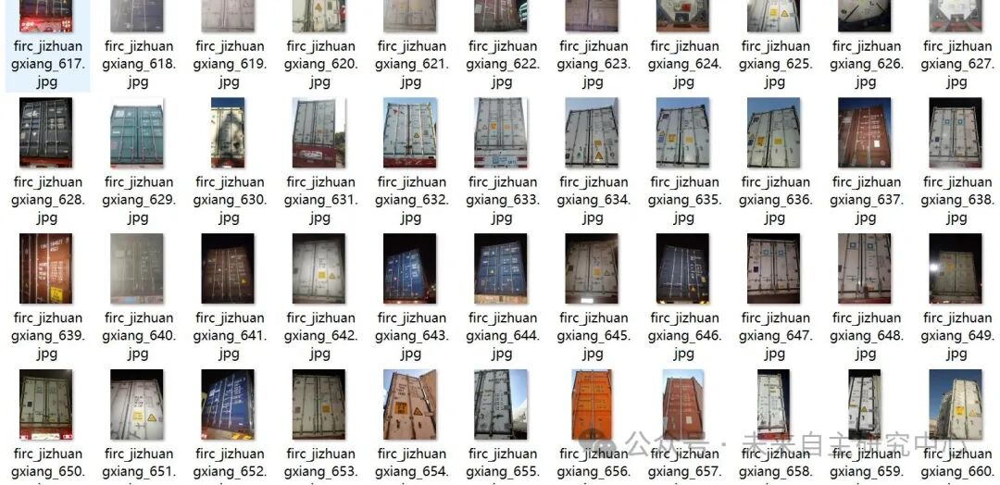
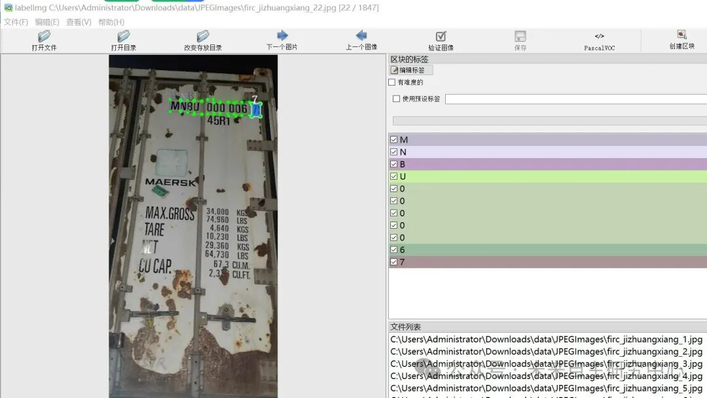

# Vehicle Containment Number Text Detection Dataset VOC+YOLO format with 1847 images and 35 categories

Dataset format: Pascal VOC format + YOLO format (txt file without split path, only containing jpg images and corresponding VOC format xml files and yolo format txt files)

Number of images (number of jpg files): 1847

Number of annotations (number of xml files): 1847

Number of annotations (number of txt files): 1847

Label category count: 35

Label category names (Note that the order in YOLO format does not correspond to this, but is based on the classes.txt file in the labels folder): ["0", "1", "2", "3", "4", "5", "6", "7", "8", "9", "A", "B", "C", "D", "E", "F", "G", "H", "I", "J", "K", "L", "M", "N", "O", "Q", "R", "S", "T", "U", "V", "W", "X", "Y", "Z"]

Number of boxes labeled in each category:

0 Frames = 1590

1 Frames = 1328

2 Frames = 1270

3 Frames = 1351

4 Frames = 1227

5 Frames = 1342

6 Frames = 1217

7 Frames = 1105

8 Frames = 1263

9 Frames = 1226

A box count = 322

B box count = 335

C box count = 507

D Frames = 156

E Frames = 265

F Frames = 98

G Frames = 177

H Frames = 125

I Frames = 120

J Frames = 4

K Frames = 277

L-box count = 279

M Frames = 717

N Frames = 323

O Frames = 186

Q Frames = 52

R Frames = 367

S Frames = 431

T-box count = 467

U Frames = 1930

V Frames = 1

W Frames = 48

X Frames = 81

Y Frames = 12

Z Frames = 101

Total frame count: 20300

Using labelImg:

Annotation rules: Draw a rectangle around the category.

Important Notice: No

Special : This dataset does not guarantee the accuracy or precision of the trained models or weight files. The dataset is provided with accurate and reasonable annotations only.

Image Preview:

Annotation example:

## Payment

Here is a pay link on Stripe ( https://buy.stripe.com/3cs8yP7sY87d0vu9AB ). Please contact me lonlonago@foxmail.com after funding $89, and I will send you a complete data files , thank you!

